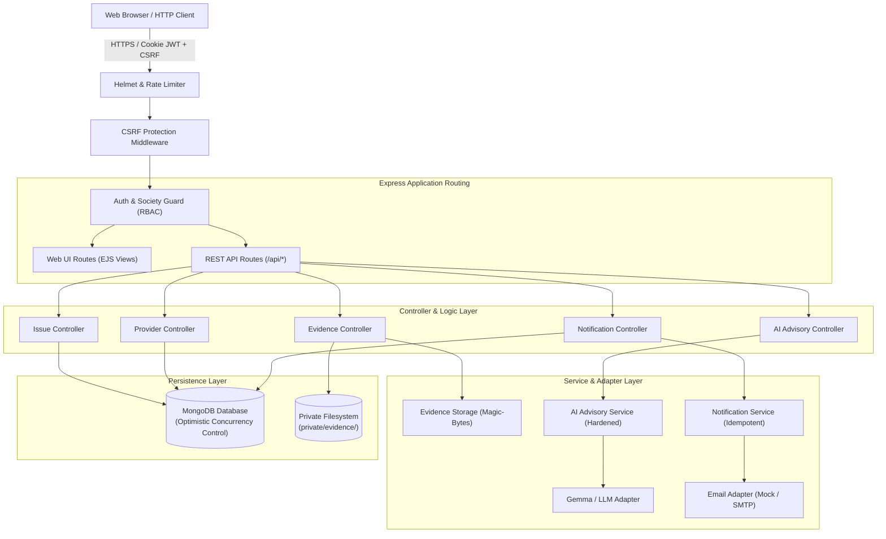
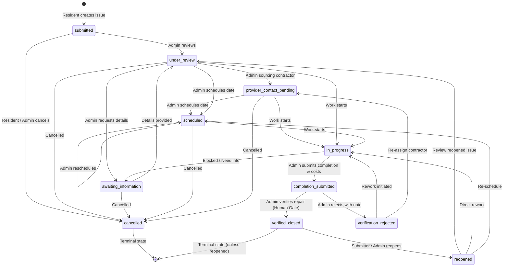

# Housing Management Portal

[](https://nodejs.org/)
[](https://expressjs.com/)
[](https://mongoosejs.com/)
[](file:///C:/Users/Aryan/Housing-Management/tests)
[](file:///C:/Users/Aryan/Housing-Management)
[](https://opensource.org/licenses/ISC)

An enterprise-grade, multi-tenant residential society issue management platform and operational workflow engine. Built with **Node.js**, **Express 5**, **MongoDB / Mongoose**, and server-rendered **EJS** with responsive vanilla JavaScript.

Designed with strict tenant isolation, role-based access control, optimistic concurrency control (OCC), privacy redactions, an immutable audit trail, a hardened AI triage advisory module, and a secure private evidence storage vault.

---

## Table of Contents

1. [Key Features & Capabilities](#key-features--capabilities)
2. [System Architecture](#system-architecture)
3. [Technology Stack](#technology-stack)
4. [Directory Structure](#directory-structure)
5. [Prerequisites & Installation](#prerequisites--installation)
6. [Environment Variables Reference](#environment-variables-reference)
7. [Running the Application](#running-the-application)
8. [Issue Lifecycle & State Machine](#issue-lifecycle--state-machine)
9. [Security & Privacy Architecture](#security--privacy-architecture)
10. [AI Advisory Module & Hardening](#ai-advisory-module--hardening)
11. [API Overview](#api-overview)
12. [Testing & Quality Assurance](#testing--quality-assurance)
13. [Current Integration Status & Stubs](#current-integration-status--stubs)
14. [Contributing & License](#contributing--license)

---

## Key Features & Capabilities

### 🏢 Multi-Tenant Society Management
- **Autonomous Tenant Isolation**: Every society maintains strictly segregated data boundaries for issues, providers, notifications, evidence, and memberships.
- **Role-Based Access Control (RBAC)**: Distinct permission scopes for `admin` (management committee) and `resident` (homeowners/tenants).
- **Membership Lifecycle**: Secure society registration, membership invitation codes, flat number assignments, and multi-society switching consoles.
- **Zero Provider Accounts**: External contractors are managed in a dedicated directory and never receive login credentials or society memberships.

### 📋 Comprehensive Issue Lifecycle Engine
- **9 Issue Categories**: `plumbing`, `electrical`, `carpentry`, `security`, `housekeeping`, `elevator`, `common_area`, `structural`, and `other`.
- **4 Priority Tiers**: `low`, `normal` (default), `high`, and `urgent`.
- **11 Lifecycle Statuses**: Finite state machine with validated transitions, mandatory note policies, and cancellation safeguards.
- **Optimistic Concurrency Control (OCC)**: Mongoose `__v` document versioning prevents mid-air write collisions with HTTP 409 responses.
- **Immutable Audit Trail**: Chronological event history logging actor IDs, timestamps, status changes, internal admin notes, and field diffs.
- **Optional & Backward-Compatible Pagination**: Default unpaginated mode preserves legacy client contracts; opt-in paginated mode (`?page=1&limit=20`) uses database-level `.skip()` and `.limit()` with deterministic sort tie-breakers.

### 🔒 Privacy & Scoped Redaction
- **Anti-ID Enumeration**: Residents attempting to view private unit issues filed by other residents receive HTTP 404 Not Found rather than 403 Forbidden.
- **Automatic Field Scrubbing**: Resident-facing responses strictly redact contractor details, repair costs, internal admin notes, and private submitter contact numbers (`toClientJSON`).
- **Common Area Visibility**: Common-area issues are visible to all society members while redacting personal contact information.

### 🛠️ Provider Directory & Criteria Matching
- **Contractor Roster**: Store vendor contact info, trade categories, service coverage areas (blocks/wings), hourly and flat rate structures.
- **Smart Suggestion Engine**: Analyzes issue trade category and physical block/wing location to match active contractors with explicit non-endorsement disclaimers.
- **Issue Assignment**: Assign and unassign contractors with full timeline tracking.

### 💰 Repair Progress, Cost Tracking & Verification
- **Granular Progress Updates**: Admin progress percentage logging (0–100%) with internal or public status notes.
- **Itemized Repair Costs**: Breakdowns for material, labor, and other costs with server-side total computation (bounded to 30M INR).
- **Human Verification Gate**: Strict admin-only verification or rejection of submitted repair completions. Rejections require an explanatory note and reopen the rework loop.

### 📁 Private Evidence Storage Vault
- **Off-Root Disk Storage**: Files stored in `private/evidence/`, outside public web roots.
- **Magic-Byte Header Validation**: Deep inspection of binary file signatures (JPEG, PNG, WebP, PDF) to prevent disguised executable uploads.
- **Secure Streaming**: Served with `X-Content-Type-Options: nosniff`, `Content-Security-Policy: default-src 'none'`, and private caching headers.

### 🤖 Hardened AI Advisory Module
- **Zero-Mutation Advisory**: Read-only triage suggestions (`suggestedCategory`, `suggestedPriority`, `explanation`, `missingInformation`).
- **Prompt Injection Defense**: Untrusted issue content is enclosed in `<reported_issue>` tags with delimiter breakout neutralization and instruction-immunity system prompts.
- **Strict Input/Output Schema Enforcement**: Hard caps on string lengths; rejects unrecognized model keys (e.g., injected `status` or `costs`).

### 🔔 In-App Notifications
- **Lifecycle Alerts**: Automated notifications for issue status changes, contractor assignments, completion submissions, and comments.
- **Compound Idempotency**: Deduplicated delivery via unique compound database indexes.
- **Pagination & Management**: Paginated notification center with unread counters and individual or batch mark-as-read endpoints.

---

## System Architecture



---

## Technology Stack

| Layer | Technology | Details |
| :--- | :--- | :--- |
| **Runtime** | Node.js | `>= 18.0.0` (LTS recommended) |
| **Framework** | Express.js | `v5.3.0` (modern async error handling) |
| **Database & ODM** | MongoDB & Mongoose | Mongoose `v9.11.2` with schema validation & OCC (`__v`) |
| **Templating Engine**| EJS | `v7.0.1` server-rendered HTML views |
| **Client Assets** | Vanilla JavaScript & CSS | Native DOM manipulation, custom CSS properties, no heavyweight frameworks |
| **Authentication** | JWT (`jsonwebtoken`) | `HttpOnly` secure cookies with atomic `tokenVersion` revocation |
| **Password Hashing** | `bcryptjs` | Salt rounds = 10 |
| **Security Headers** | `helmet` | Content Security Policy, X-Frame-Options, DNS prefetch control |
| **File Uploads** | `multer` | Multipart form parsing with memory streaming |
| **Rate Limiting** | `express-rate-limit` | Global window limiting and dedicated AI triage limits |
| **Test Runner** | Native Node.js Test Runner | `node --test` with built-in assertion module (`node:assert`) |

---

## Directory Structure

```text
Housing-Management/
├── config/
│   └── db.js                        # MongoDB connection lifecycle & failover
├── controllers/
│   ├── aiAdvisoryController.js      # AI triage recommendation handler
│   ├── authController.js            # User registration, login, logout, profile
│   ├── evidenceController.js        # File upload and secure streaming
│   ├── issueController.js           # Issue CRUD, state transitions, pagination
│   ├── notificationController.js    # In-app notification feeds & read tracking
│   ├── providerController.js        # Contractor directory & suggestion matching
│   └── societyController.js         # Society creation, onboarding, memberships
├── docs/
│   └── API_DOCUMENTATION.md         # Comprehensive REST API & backend reference
├── middleware/
│   ├── auth.js                      # JWT authentication & session token versioning
│   ├── csrf.js                      # Cryptographic HMAC double-submit CSRF defense
│   ├── errorHandler.js              # Centralized error handler & OCC 409 mapper
│   └── societyGuard.js              # Multi-tenant isolation & RBAC validation
├── models/
│   ├── Issue.js                     # Issue schema, lifecycle history, costs, OCC
│   ├── Notification.js              # In-app alert schema with compound idempotency
│   ├── Provider.js                  # Contractor directory schema & service areas
│   ├── Society.js                   # Residential society tenant records
│   ├── SocietyMembership.js         # User-to-society mapping, roles, flat numbers
│   └── User.js                      # User accounts, password hashes, tokenVersion
├── private/
│   └── evidence/                    # Off-root secure storage for evidence files
├── public/
│   ├── css/
│   │   └── main.css                 # Responsive stylesheet & UI theme
│   └── js/
│       ├── auth.js                  # Client authentication helpers
│       ├── issue-details.js         # Timeline, status transition, & triage modal logic
│       ├── issues.js                # Resident & admin issue queue filtering
│       ├── main.js                  # Global navigation & theme scripts
│       ├── notifications.js         # Notification center polling & read toggles
│       └── providers.js             # Contractor directory management logic
├── routes/
│   ├── authRoutes.js                # /api/auth endpoints
│   ├── healthRoutes.js              # /health readiness endpoint
│   ├── issueRoutes.js               # /api/societies/:societyId/issues endpoints
│   ├── notificationRoutes.js       # /api/societies/:societyId/notifications endpoints
│   ├── providerRoutes.js           # /api/societies/:societyId/providers endpoints
│   ├── societyRoutes.js            # /api/societies endpoints
│   └── webRoutes.js                 # Web UI routes rendering EJS views
├── services/
│   ├── ai/
│   │   ├── aiAdvisoryService.js     # Hardened AI advisory logic & sanitization
│   │   └── gemmaAdapter.js          # HTTP adapter for Gemma LLM endpoints
│   ├── evidence/
│   │   └── evidenceStorageService.js # Magic-byte MIME verification & disk storage
│   └── notifications/
│       ├── emailAdapter.js          # Pluggable email notification adapter
│       └── notificationService.js   # Event dispatcher & idempotency engine
├── tests/                           # 61 test suites (321 automated unit/integration tests)
│   ├── aiAdvisory.test.js           # Prompt injection, schema, & bounds tests
│   ├── auth.test.js                 # Authentication, JWT, and CSRF tests
│   ├── db.test.js                   # Database connection failover tests
│   ├── evidenceUpload.test.js       # Magic-byte and evidence streaming tests
│   ├── headlessVerification.test.js # Headless security invariant checks
│   ├── health.test.js               # System health endpoint tests
│   ├── issue.test.js                # State machine, privacy, and pagination tests
│   ├── notification.test.js         # Notification deduplication & pagination tests
│   ├── provider.test.js             # Contractor directory & suggestion tests
│   ├── repairWorkflow.test.js       # Costs, completion, & verification tests
│   └── webRoutes.test.js            # EJS page rendering & UI route tests
├── views/                           # Server-rendered EJS templates
│   ├── admin/                       # Admin contractor directory views
│   ├── auth/                        # Login, registration, & verification views
│   ├── dashboard/                   # Resident, admin, & society selector views
│   ├── issues/                      # Issue creation, details, & error views
│   ├── layouts/                     # Master application layout wrapper
│   ├── notifications/               # Notification center views
│   └── partials/                    # Header, footer, navbar reusable components
├── .env.example                     # Environment template with sensible defaults
├── package.json                     # Project manifest and scripts
├── README.md                        # Project documentation (this file)
└── server.js                        # Application entry point & HTTP listener
```

---

## Prerequisites & Installation

### Prerequisites
1. **Node.js**: `v18.0.0` or higher (`v24.x` recommended).
2. **npm**: `v9.0.0` or higher.
3. **MongoDB**: Local MongoDB instance running on `mongodb://127.0.0.1:27017` or remote MongoDB connection URI.

### Installation Steps

1. **Clone the repository**:
   ```bash
   git clone https://github.com/Aryan544-arch/Housing-Management.git
   cd Housing-Management
   ```

2. **Install project dependencies**:
   ```bash
   npm install
   ```

3. **Configure environment variables**:
   ```bash
   cp .env.example .env
   ```
   Edit `.env` to configure your MongoDB connection string and security secrets.

---

## Environment Variables Reference

| Variable | Type | Default | Description |
| :--- | :--- | :--- | :--- |
| `PORT` | Number | `3000` | HTTP port for server listener. |
| `NODE_ENV` | String | `development` | Environment mode (`development`, `production`, `test`). Enforces secure cookies and hides stack traces in production. |
| `MONGODB_URI` | String | `mongodb://127.0.0.1:27017/housing_management` | Active MongoDB connection string. |
| `JWT_SECRET` | String | *Placeholder* | HMAC-SHA256 signing secret. **Must be $\ge$ 32 characters in production**. |
| `CSRF_SECRET` | String | *Falls back to JWT_SECRET* | Cryptographic signing secret for CSRF double-submit cookies. |
| `AI_ADVISORY_ENABLED` | Boolean | `false` | Global toggle for AI advisory suggestions. |
| `AI_PROVIDER` | String | `gemma` | Active adapter (`gemma`, `mock`). |
| `GEMMA_API_URL` | String | `https://api.example.com/v1/chat/completions` | Remote Gemma LLM HTTP endpoint. |
| `GEMMA_API_KEY` | String | *Placeholder* | Bearer token for LLM API service. |
| `GEMMA_MODEL` | String | `gemma-2-9b-it` | Target model name. |
| `AI_TIMEOUT_MS` | Number | `10000` | Upstream AI request timeout (returns 504 on expiry). |
| `NOTIFICATION_ENABLED` | Boolean | `true` | Toggle for database-persisted in-app alerts. |
| `EMAIL_ENABLED` | Boolean | `false` | Toggle for outbound email dispatch. |
| `EMAIL_PROVIDER` | String | `mock` | Active email adapter (`mock`, `smtp`). |
| `EMAIL_FROM` | String | `noreply@housing.local` | Outbound email sender header. |
| `SMTP_HOST` | String | `""` | SMTP mail server hostname. |
| `SMTP_PORT` | Number | `587` | SMTP port (`587` for STARTTLS, `465` for SSL). |
| `SMTP_USER` | String | `""` | SMTP username. |
| `SMTP_PASS` | String | `""` | SMTP password. |
| `SMTP_SECURE` | Boolean | `false` | SSL wrapper toggle. |
| `EVIDENCE_STORAGE_DIR` | String | `private/evidence` | Filesystem folder for uploaded evidence attachments. |
| `MAX_EVIDENCE_FILE_SIZE_BYTES` | Number | `5242880` | Maximum upload file size (5 MB). |
| `ALLOWED_EVIDENCE_MIME_TYPES` | String | `image/jpeg,image/png,image/webp,application/pdf` | Whitelisted MIME types for attachments. |

---

## Running the Application

### Standard Startup
```bash
npm start
```
Connects to MongoDB and binds the HTTP listener to `http://localhost:3000`.

### Development Mode (with Live Reload)
```bash
npm run dev
```
Starts the server using `nodemon` for auto-reloading upon file edits.

### Verification of Local Server
Once running, check system readiness:
```bash
curl http://localhost:3000/health
```
Response:
```json
{
  "status": "ok",
  "timestamp": "2026-10-18T12:56:12.573Z",
  "uptime": 42.1,
  "environment": "development",
  "database": { "status": "connected" }
}
```

---

## Issue Lifecycle & State Machine



### Transition Authority Table

| From Status | Permitted To Status | Authorized Roles | Mandatory Payload Requirements |
| :--- | :--- | :--- | :--- |
| `submitted` | `under_review` | Admin | Optional review note |
| `submitted` | `cancelled` | Admin, Resident (Submitter only) | `cancellationReason` + note |
| `under_review` | `awaiting_information` | Admin | Explanatory note |
| `under_review` | `provider_contact_pending` | Admin | Note |
| `under_review` | `scheduled` | Admin | `scheduledDate` (valid future date) |
| `under_review` | `in_progress` | Admin | Note |
| `awaiting_information` | `under_review` | Admin, Resident (Submitter only) | Note |
| `provider_contact_pending` | `scheduled` | Admin | `scheduledDate` |
| `scheduled` | `in_progress` | Admin | Note |
| `in_progress` | `completion_submitted` | Admin | Itemized `costs` & `completionDetails` |
| `completion_submitted` | `verified_closed` | **Admin only** (Residents forbidden) | Final verification note |
| `completion_submitted` | `verification_rejected` | **Admin only** (Residents forbidden) | Mandatory rejection reason note |
| `verification_rejected` | `in_progress` | Admin | Rework instructions |
| `verified_closed` | `reopened` | Admin, Resident (Submitter only) | Mandatory reason note |
| `cancelled` | *None* | — | Terminal state |

---

## Security & Privacy Architecture

### 1. Cryptographic CSRF Defense
- Safe HTTP methods (`GET`, `HEAD`, `OPTIONS`) issue an HMAC-SHA256 signed `_csrf` cookie formatted as `<rawToken>.<hmacSignature>`.
- Mutating methods (`POST`, `PUT`, `PATCH`, `DELETE`) require the raw token in the `X-CSRF-Token` header or form body.
- Uses `crypto.timingSafeEqual` to prevent timing attacks.
- Enforces strict `Origin` and `Referer` host matching against the `Host` header.

### 2. Multi-Tenant Cross-Society Isolation
- All database records strictly bind to `society: ObjectId`.
- `requireSocietyMember(allowedRoles)` middleware validates the authenticated user's active membership in the requested `:societyId`. Cross-society requests are blocked with HTTP 403.

### 3. Anti-Enumeration & Privacy Scoping
- If a resident attempts to access another resident's private unit issue, the controller responds with **HTTP 404 Not Found** (identical to a non-existent ID) to completely block issue ID enumeration.
- The `toClientJSON(requesterRole, requesterUserId)` schema transform strips sensitive metadata (contractor phone, repair costs, admin internal notes) before serializing payloads to residents.

### 4. Binary File Magic-Byte Validation
- Files uploaded via `POST /evidence` have their binary headers checked against known signatures:
  - **JPEG**: `FF D8 FF`
  - **PNG**: `89 50 4E 47`
  - **WebP**: `52 49 46 46` ... `57 45 42 50`
  - **PDF**: `25 50 44 46` (`%PDF`)
- Files with mismatched extensions or executable payloads disguised as images are rejected with HTTP 400.

---

## AI Advisory Module & Hardening

The AI Advisory service (`services/ai/aiAdvisoryService.js`) assists society committees during issue triage by providing categorization, priority assessment, and missing-information questions.

### Security Invariants
1. **Instruction Immunity**: The system prompt declares absolute instruction immunity, directing the model to treat all text enclosed in `<reported_issue>` tags strictly as untrusted maintenance descriptions.
2. **Delimiter Sanitization**: Malicious tags such as `</reported_issue>` in user input are neutralized to `[/reported_issue]`.
3. **Hard Length Bounds**:
   - Issue Title: 120 characters
   - Issue Description: 2,000 characters
   - Category / Location: 50 / 30 characters
   - Combined User Prompt: 4,000 characters
4. **Strict Output Whitelisting**: Rejects unexpected or injected keys (such as `status`, `costs`, `adminAccess`). Only `suggestedCategory`, `suggestedPriority`, `explanation`, and `missingInformation` are accepted.
5. **Read-Only Invariant**: The advisory service never mutates database documents or alters issue statuses.
6. **Exception Safety**: Gracefully handles null/undefined inputs (400 Bad Request) and invalid model responses (502 Bad Gateway) without leaking stack traces or internal environment variables.

---

## API Overview

For detailed request and response contracts, schema definitions, and error shapes, refer to [`docs/API_DOCUMENTATION.md`](file:///C:/Users/Aryan/Housing-Management/docs/API_DOCUMENTATION.md).

| Domain | Method | Endpoint | Access Scope |
| :--- | :--- | :--- | :--- |
| **System** | `GET` | `/health` | Public |
| **Authentication** | `POST` | `/api/auth/register` | Public |
| | `POST` | `/api/auth/login` | Public |
| | `POST` | `/api/auth/logout` | Authenticated |
| | `GET` | `/api/auth/me` | Authenticated |
| **Society** | `POST` | `/api/societies` | Authenticated |
| | `GET` | `/api/societies/:societyId` | Active Society Member |
| | `GET` | `/api/societies/:societyId/members` | Active Society Member |
| | `POST` | `/api/societies/:societyId/members` | Society Admin |
| **Issues** | `POST` | `/api/societies/:societyId/issues` | Active Society Member |
| | `GET` | `/api/societies/:societyId/issues` | Active Society Member (Optional `?page=&limit=`) |
| | `GET` | `/api/societies/:societyId/issues/:issueId` | Active Society Member (Scoped privacy) |
| | `PATCH`| `/api/societies/:societyId/issues/:issueId` | Submitter or Admin |
| | `PATCH`| `/api/societies/:societyId/issues/:issueId/status` | Submitter or Admin |
| | `POST` | `/api/societies/:societyId/issues/:issueId/notes` | Active Society Member |
| | `POST` | `/api/societies/:societyId/issues/:issueId/progress`| Society Admin |
| | `POST` | `/api/societies/:societyId/issues/:issueId/evidence`| Active Society Member |
| | `GET` | `/api/societies/:societyId/issues/:issueId/evidence/:evidenceId` | Active Society Member |
| | `POST` | `/api/societies/:societyId/issues/:issueId/ai-advisory` | Active Society Member |
| **Providers** | `POST` | `/api/societies/:societyId/providers` | Society Admin |
| | `GET` | `/api/societies/:societyId/providers` | Society Admin |
| | `GET` | `/api/societies/:societyId/providers/:providerId` | Society Admin |
| | `PATCH`| `/api/societies/:societyId/providers/:providerId` | Society Admin |
| | `DELETE`| `/api/societies/:societyId/providers/:providerId` | Society Admin |
| | `GET` | `/api/societies/:societyId/providers/suggestions/:issueId` | Society Admin |
| **Notifications** | `GET` | `/api/societies/:societyId/notifications` | Active Society Member |
| | `PATCH`| `/api/societies/:societyId/notifications/:notificationId/read` | Recipient Owner |
| | `PATCH`| `/api/societies/:societyId/notifications/read-all` | Recipient Owner |

---

## Testing & Quality Assurance

The Housing Management Portal includes an automated test suite executed with Node's native test runner (`node --test`), requiring zero external test frameworks.

### Running the Full Test Suite
```bash
npm test
```
**Current Status**: **321 tests passing across 61 test suites (0 failures)**.

### Running Targeted Test Suites
```bash
# Issue lifecycle, privacy redaction, OCC, and optional pagination tests (60 tests)
node --test tests/issue.test.js

# AI Advisory hardening, prompt injection defense, and schema validation tests (35 tests)
node --test tests/aiAdvisory.test.js

# Web UI routes and EJS rendering tests (52 tests)
node --test tests/webRoutes.test.js

# Evidence upload, magic-byte checking, and secure streaming tests (18 tests)
node --test tests/evidenceUpload.test.js

# Repair workflow, cost tracking, and admin verification tests (30 tests)
node --test tests/repairWorkflow.test.js

# Contractor directory and criteria suggestion tests (26 tests)
node --test tests/provider.test.js

# Authentication, token versioning, and CSRF protection tests (39 tests)
node --test tests/auth.test.js

# In-app notifications and idempotency tests (23 tests)
node --test tests/notification.test.js
```

### Production Dependency Security Audit
```bash
npm audit --omit=dev
```
**Result**: `found 0 vulnerabilities`.

---

## Current Integration Status & Stubs

1. **Email Delivery**:
   - The outbound email subsystem uses `services/notifications/emailAdapter.js`.
   - By default, `EMAIL_ENABLED=false` and `EMAIL_PROVIDER=mock`, which simulates delivery in test/dev modes. Real SMTP delivery requires setting valid credentials in `.env` (`SMTP_HOST`, `SMTP_PORT`, `SMTP_USER`, `SMTP_PASS`).
2. **AI Model Endpoint**:
   - External LLM inference is disabled by default (`AI_ADVISORY_ENABLED=false`).
   - The test suite utilizes `MockAiAdapter`. Live inference requires setting `AI_ADVISORY_ENABLED=true` with a valid `GEMMA_API_URL` and `GEMMA_API_KEY`.
3. **Realtime WebSockets**:
   - Realtime WebSockets are not enabled. Notifications operate via polling and dedicated HTTP endpoints.
4. **Email Address Verification**:
   - User registration activates accounts immediately. The `/verify-email` route serves an informational status view.

---

## Contributing & License

### Code Quality Standards
- Run `npm test` before committing any code changes.
- Ensure `git diff --check` passes with zero whitespace errors.
- Preserve existing comment documentation, schema validation rules, and privacy redactions.

### License
This project is licensed under the **ISC License**.
